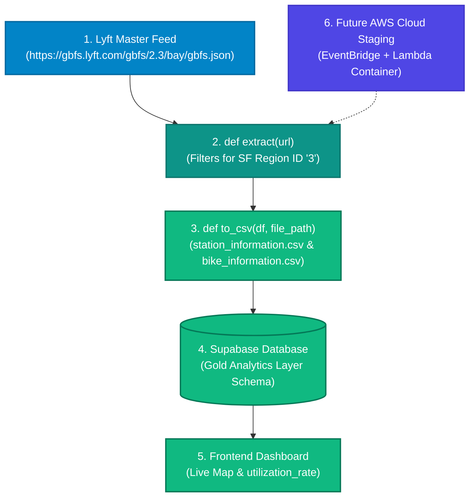

# 🗺️ Team 2 Refined Architecture Diagram (SF Bike Share GBFS)

This flowchart outlines how our San Francisco Bike Share data moves from the public API into our local file tracks, analytical databases, and downstream user dashboard metrics [INDEX].

---

### 1. Visual Infrastructure Flowchart

---

### 2. Core Pipeline Components Explained
* **Blue (Source):** The dynamic, live public Lyft master feed (`https://gbfs.lyft.com/gbfs/2.3/bay/gbfs.json`) providing auto-discovery access to station and status structures.
* **Teal (Engine):** Our Python execution layer running `extract(url)` to filter data strictly down to San Francisco (`region_id == "3"`) and apply geospatial boundary truncations [INDEX].
* **Green (Storage & UI):** Our local storage handlers calling `to_csv()` for station and bike logs, updating our indexed time-series tables in Supabase, and mapping fields like `utilization_rate` directly onto the interactive client dashboard map.
* **Indigo (Cloud Plan):** Our architecture blueprint to host our decoupled data collection script inside a serverless AWS Lambda cron workflow container later [INDEX].
