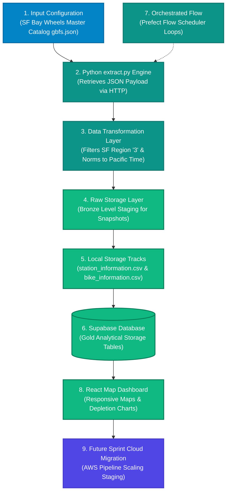

# 🗺️ Team 2 Refined Architecture Diagram (SF Bike Share GBFS)

This flowchart outlines how our San Francisco Bike Share data moves from the public API into our local file tracks, analytical databases, and downstream user dashboard metrics [INDEX].

---

### 1. Visual Infrastructure Flowchart

---

### 2. Core Pipeline Components Explained
* **Input Configuration (Blue):** Live master configurations from the SF Bay Wheels GBFS auto-discovery catalog endpoint (`gbfs.json`), capturing dynamic system snapshot links [6.0].
* **Teal Engines:** Our Python data execution layer querying endpoints via HTTP requests, filtering strictly for San Francisco coordinates (`region_id == '3'`), and normalizing execution timestamps to Pacific Time (`America/Los_Angeles`) [6.0].
* **Raw Storage & Local Storage Tracks (Green):** Our pipeline export architecture managing a raw data storage snapshot layer before saving processed datasets locally to clean tracking files (`station_information.csv` and `bike_information.csv`) [6.0].
* **Supabase & UI (Green):** Loading structured records into target database columns to power our frontend React map dashboard tracking metrics like `utilization_rate` [6.0].
* **Orchestrated Flow (Teal):** Our automated scheduling loop controlled by Prefect to handle steady, repetitive snapshot capture cycles.
* **Indigo Cloud Plan:** Our high-level architecture blueprint plan to transition our local automation engines into highly scalable cloud computing triggers later in the project lifecycle.
