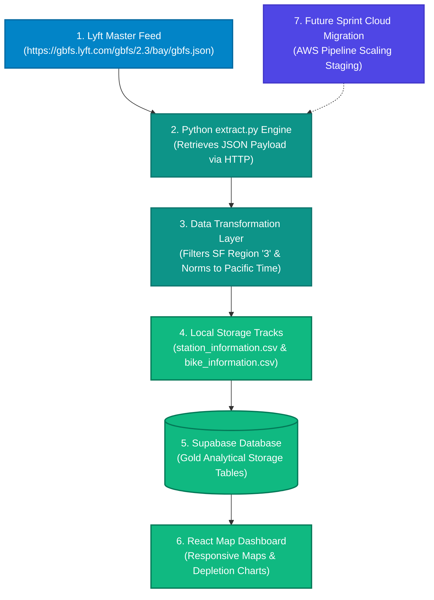

# 🗺️ Team 2 Refined Architecture Diagram (SF Bike Share GBFS)

This flowchart outlines how our San Francisco Bike Share data moves from the public API into our local file tracks, analytical databases, and downstream user dashboard metrics [INDEX].

---

### 1. Visual Infrastructure Flowchart

---

### 2. Core Pipeline Components Explained
** **Blue (Source):** Live feeds from the SF Bay Wheels GBFS auto-discovery catalog endpoint (`gbfs.json`), capturing dynamic system snapshots [6.0].
* **Teal (Engine):** Our Python data execution layer querying endpoints via HTTP requests, filtering strictly for San Francisco coordinates (`region_id == '3'`), and normalizing execution timestamps to Pacific Time (`America/Los_Angeles`) [6.0].
* **Green (Storage & UI):** Our pipeline export architecture saving processed data locally to clean tracking files (`station_information.csv` and `bike_information.csv`) before loading structured records into Supabase to power our frontend React map dashboard [6.0].
* **Indigo (Cloud Plan):** Our high-level architecture blueprint plan to transition our local automation engines into highly scalable cloud computing triggers later in the project lifecycle.
